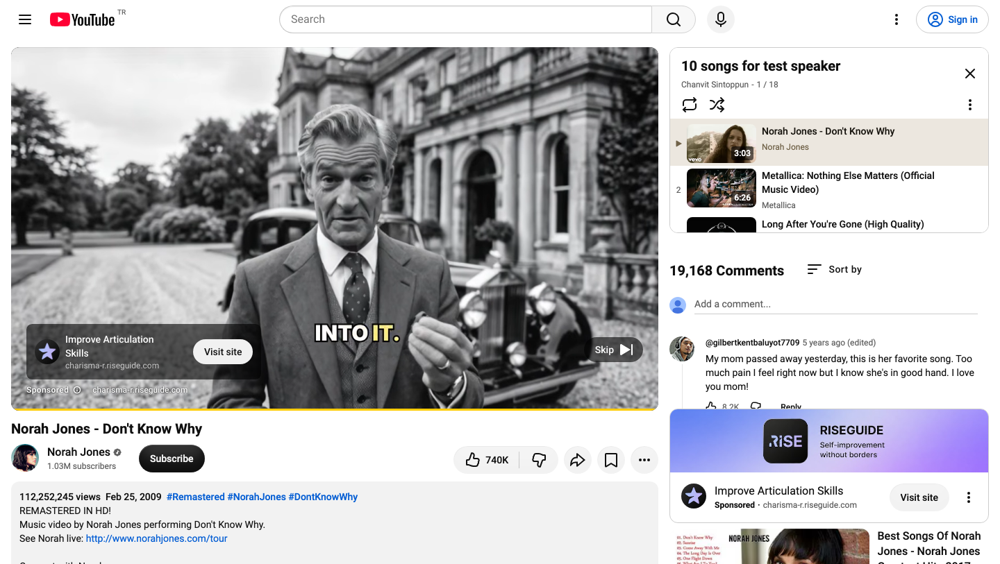

# YouTube: Comments on the Right

A userscript that moves YouTube's comments section into the right-hand column next to the video. The page itself is locked in place, so the video never moves — you scroll the comments independently.

## Features

- Moves `#comments` into the secondary (right) column.
- Locks the watch page to the viewport so it can't scroll.
- Gives the right column its own scrollbar (`overflow-y: auto`, `overscroll-behavior: contain`).
- Keeps YouTube's lazy loading of additional comments working.
- Survives YouTube's in-page (SPA) navigation.
- Supports both the current light-DOM watch page and older shadow-DOM layouts.
- Small on-page debug badge that reports what the script found.

## Install

### From Greasy Fork / OpenUserJS
Install with one click from the script's page on [Greasy Fork](https://greasyfork.org) or [OpenUserJS](https://openuserjs.org), after installing [Tampermonkey](https://www.tampermonkey.net/) or [Violentmonkey](https://violentmonkey.github.io/).

### From GitHub
1. Install [Tampermonkey](https://www.tampermonkey.net/) or [Violentmonkey](https://violentmonkey.github.io/).
2. Open the [raw `.user.js` file](youtube-comments-right.user.js) — your userscript manager should offer to install it.
3. Confirm installation, then open any YouTube `/watch` video.

### Manual
Copy the entire contents of `youtube-comments-right.user.js` (including the `// ==UserScript==` header), create a new script in your userscript manager, paste, and save.

## Configuration

Edit the `CONFIG` object near the top of the script:

| Option | Default | Description |
| --- | --- | --- |
| `sidebarWidth` | `460` | Width in pixels of the right column. |
| `hideRecommendations` | `false` | Set `true` to hide suggested videos below the comments. |
| `lockPage` | `true` | Prevent the whole page from scrolling. Set `false` to restore normal page scrolling. |
| `scrollableSidebar` | `true` | Give the right column its own scrollbar. |
| `topOffset` | `56` | Height of YouTube's masthead in pixels; used to size the column. |
| `showDebugBadge` | `false` | Set `true` to show the green diagnostic badge when troubleshooting. |

## Troubleshooting

The green badge at the bottom-left reports the script status:

- `OK ✓ (comments in scrollable right column)` — working.
- `waiting: no ytd-watch-flexy` — the script isn't running on a `/watch` URL.
- `column #secondary NOT FOUND` — YouTube changed its layout; open an issue with your browser version.
- No badge at all — the script isn't installed/enabled, or the `// ==UserScript==` header was lost when copying.

If a YouTube redesign breaks it, the selectors to check are in the `apply()` function (`#comments`, `#secondary`, `ytd-watch-flexy`).

## Compatibility

- YouTube desktop watch pages (`youtube.com/watch*`, `www.youtube.com/watch*`).
- Chrome, Firefox, Edge, Brave, and other browsers with Tampermonkey or Violentmonkey.
- Theaters/fullscreen may hide the right column by design; the script does not override that.
- With `lockPage: true`, content below the video (e.g. the full description) is clipped because the page cannot scroll.

## Publishing notes

Replace `YOUR_USERNAME` in the userscript header's `@namespace`, `@author`, `@homepage`, `@source`, and `@supportURL` with your GitHub username before publishing. Bump `@version` for every release so users get update notifications.

## Security and privacy

The script makes **no network requests** (no `fetch`, `XMLHttpRequest`, or `GM_xmlhttpRequest`), reads **no credentials or storage** (cookies, `localStorage`, form values), and uses **no privileged APIs**. It contains no `eval` or `innerHTML`. It only moves an existing DOM node and injects a static `<style>` block, and is restricted to YouTube watch pages by `@match`.

As with any userscript, the main risks are supply-chain related: keep 2FA enabled on the publishing GitHub account and review version changes before allowing auto-updates.

## License

MIT — see [LICENSE](LICENSE).

This is an unofficial, personal-convenience tool and is not affiliated with or endorsed by YouTube or Google.
